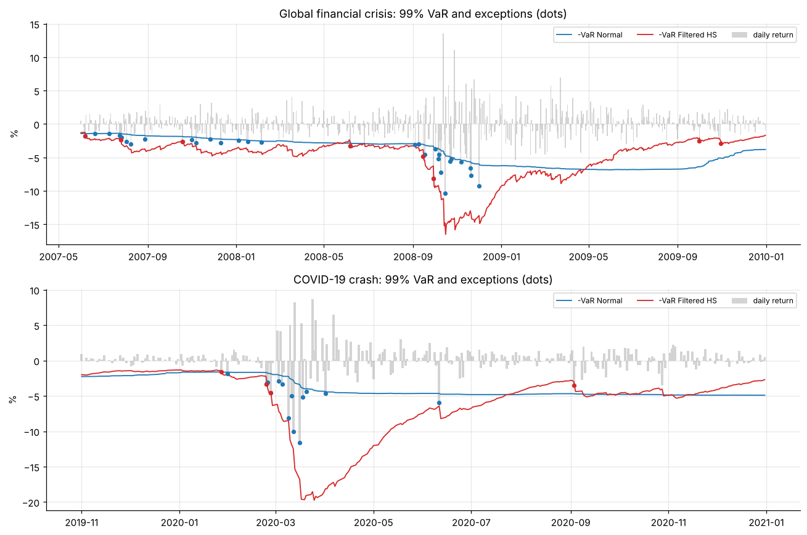
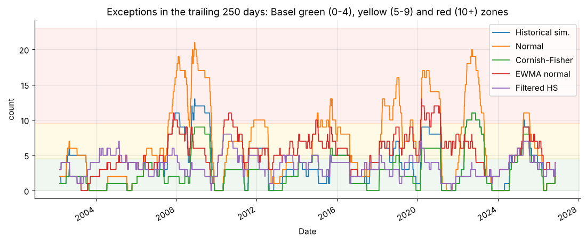
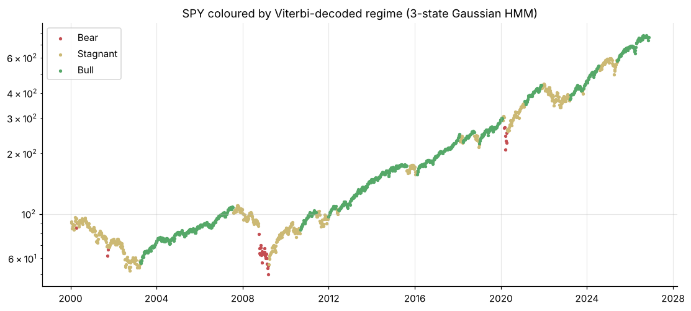
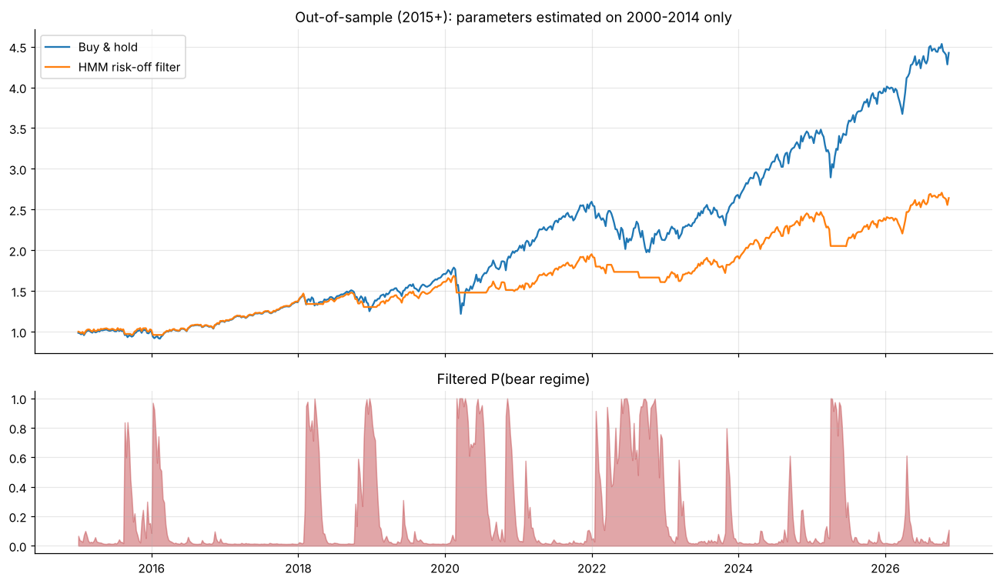

# Market Risk Models: VaR/ES Backtesting, Hidden Markov Regimes, Bayesian Networks

Three market-risk toolkits, each validated with the tests a risk-model reviewer would ask for:

1. **VaR & Expected Shortfall** with five estimators, backtested over 25 years of SPY with **Kupiec, Christoffersen and Basel traffic-light** tests
2. A **Gaussian Hidden Markov Model built from scratch** (scaled forward-backward, Viterbi, Baum-Welch EM) for market regimes, used out-of-sample as a risk overlay
3. **Bayesian networks** (pgmpy) linking macro drivers (rates, inflation, growth, dollar, equities) to crude oil, with an expert structure compared against a data-learned one



## Highlights

| Notebook | Key results |
|---|---|
| [01 · VaR/ES backtesting](notebooks/01_var_es_backtesting.ipynb) | Normal VaR breaches 2.5× too often; Cornish-Fisher hits the right *count* but its exceptions cluster; **filtered historical simulation** is the only model kept out of the Basel red zone, with ES calibrated to within 4% |
| [02 · HMM regimes](notebooks/02_hidden_markov_regimes.ipynb) | BIC selects 3 regimes (bull ~10% vol, stagnant, crisis ~55% vol lasting ~5 weeks); the custom EM beats `hmmlearn`'s likelihood; out-of-sample the filter **halves max drawdown** (−18% vs −32%) at the cost of return |
| [03 · Bayesian network for oil](notebooks/03_bayesian_network_oil.ipynb) | Expert network encodes the dollar/growth/inflation story (AUC 0.59 out-of-sample) but is over-confident; structure learning finds macro links and **no** link to next-month oil |

<p float="left">
  
  
</p>


## Quick start

```bash
git clone https://github.com/drimranbhatti/market-risk-models.git
cd market-risk-models
pip install -e ".[bayes,notebooks,dev]"
pytest                         # 6 tests
python scripts/fetch_data.py   # optional: refresh SPY (Yahoo) and macro data (FRED)
jupyter lab notebooks/
```

```python
from riskmodels import var, backtest, hmm
v = var.filtered_hs(returns, window=250, alpha=0.99)          # VaR and ES, no look-ahead
backtest.summary(returns, {"FHS": v["VaR"]})                  # Kupiec, Christoffersen, Basel zone
model, ll_path = hmm.baum_welch(weekly_returns, K=3)          # from-scratch EM
regimes = model.viterbi(weekly_returns)
```

## Package
`src/riskmodels/`
* `var`: historical simulation, Gaussian, Cornish-Fisher, RiskMetrics EWMA, filtered HS (VaR and ES)
* `backtest`: exceptions, Kupiec POF, Christoffersen independence/conditional coverage, Basel traffic light
* `hmm`: `GaussianHMM` (forward-backward, posterior, Viterbi, stationary distribution, expected durations, sampling) and `baum_welch` with restarts, plus BIC
* `bayesnet`: look-ahead-free tercile discretisation of FRED macro series

Tests check the forward algorithm against brute-force enumeration over all state paths, that EM log-likelihood never decreases, recovery of known HMM parameters (> 90% of Viterbi states correct), Gaussian VaR against theory, Kupiec rejection of a bad model, and that discretisation thresholds never use test data.

## Data
SPY adjusted closes (Yahoo Finance, 2000-2026); monthly fed funds, CPI, industrial production, WTI and broad dollar index (FRED, Federal Reserve Bank of St. Louis).

## References
Kupiec (1995) · Christoffersen (1998) · Basel Committee, *Supervisory framework for backtesting* (1996) · Barone-Adesi, Giannopoulos & Vosper (1999) · J.P. Morgan RiskMetrics (1996) · Rabiner (1989) · Hamilton (1989) · Koller & Friedman, *Probabilistic Graphical Models* (2009)

---
**Author:** Dr. Muhammad Imran Bhatti, PhD (Finance), MScFE · FCMA · [LinkedIn](https://www.linkedin.com/in/drimranbhatti) · [imranbhatti.com](https://imranbhatti.com)

*Built on my MScFE risk-management coursework (WorldQuant University) and rewritten as a standalone, tested library. Research only; not investment advice. MIT licensed.*
